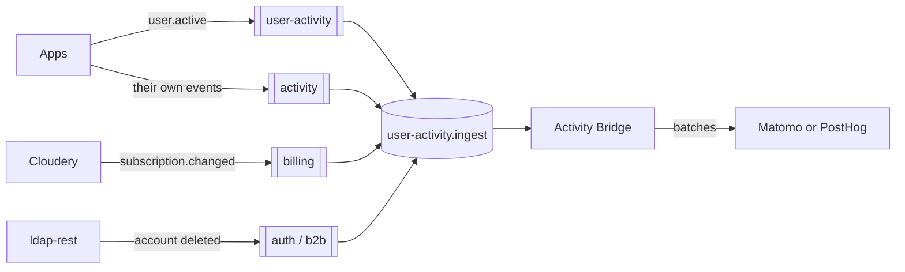

# Documentation

The Activity Bridge reads events from RabbitMQ and records them as product analytics in Matomo or PostHog. Apps never call the backend, users reach it as a pseudonym only, and the bridge keeps no state, so replicas scale out. It is a side service as defined in [ADR 068](https://github.com/linagora/twake-workplace-private/blob/99c6628bc22cdc704a941c93cc93011e70c995d9/documentation/docs/adrs/adr-068.md).

## Architecture

- [Overview](architecture/overview.md): terms and message flow.
- [Scaling](architecture/scaling.md): replicas and ordering.
- [Failures](architecture/failures.md): what happens to a message that cannot be recorded.

## Sources

- [Activity](sources/activity.md): active users, platforms and organizations. Always on.
- [Feature counts](sources/feature-counts.md): from the apps' `activity` feed.
- [Paying users](sources/paying-users.md): from cloudery's subscription changes.
- [Erasure](sources/erasure.md): deleting a user's analytics when their account is deleted.

## Backends

- [Matomo](backends/matomo.md)
- [PostHog](backends/posthog.md)
- [Switching backends](backends/switching.md)

## Configuration

- [Required settings](configuration/required.md)
- [Sources](configuration/sources.md)
- [Tuning](configuration/tuning.md): RabbitMQ, batching and the server.

## Security

- [Data](security/data.md): what leaves the bridge.
- [Access](security/access.md): keys and RabbitMQ permissions.

## Operations

- [Probes](operations/probes.md)
- [Metrics and alerts](operations/metrics.md)
- [Dead letter queue](operations/dead-letter-queue.md)

## Integration, for app developers

- [The event](integration/event.md)
- [When to publish](integration/when-to-publish.md)
- [Publishing](integration/publishing.md)
- [Hook points](integration/hook-points.md): where each app can publish from.

## Development

- [Local setup](development/local-setup.md): the bridge and a local Matomo with demo data.
- [Delivery](development/delivery.md): CI, images and releases.
