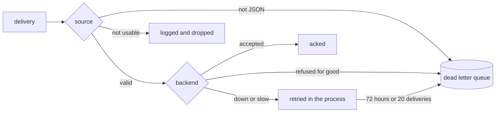

# Failures

- A message that is not JSON goes to the dead letter queue.
- A message the source cannot use is logged and dropped. The feed is the exception: it belongs to the apps, so the bridge skips what it cannot use there, without a log.
- A hit the backend refuses for good goes to the dead letter queue. When the backend refuses a whole batch, the bridge splits it until only the refused hits are left.
- Any other failure, such as a backend outage, retries in the process with a capped backoff, so messages wait in the queue. A message still there after 72 hours, or delivered more than 20 times, goes to the dead letter queue.

[Dead letter queue](../operations/dead-letter-queue.md) says how to replay it.
