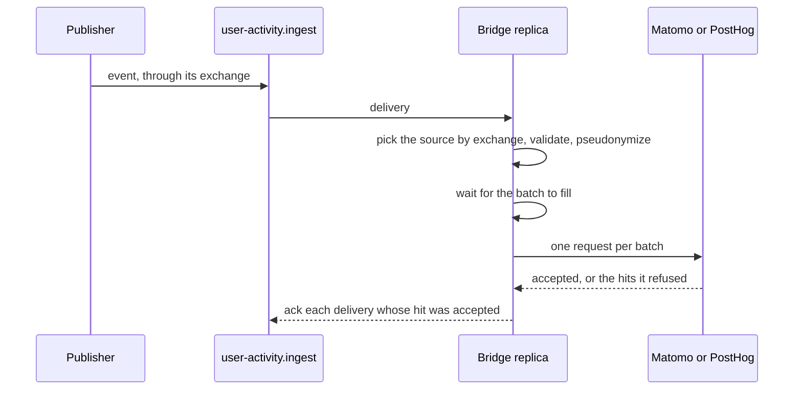

# Overview

## Terms

- App: a Twake Workplace application, such as `mail` or `chat`. Each app is one Matomo site, or one `app` property in PostHog.
- Source: one kind of message the bridge reads, from one exchange.
- Hit: what the bridge sends to the backend for one message: an app, a pseudonym, a time, a category and an action, plus the tenant, platform and IP address when known.
- Pseudonym: the HMAC-SHA256 of the user's lowercased address with `PSEUDONYM_PEPPER`. The backend knows users by it only.
- Tenant: the user's LDAP organization id, absent for a user with no organization.

## Message flow

Every source shares one quorum queue, `user-activity.ingest`. The bridge declares its own exchange, `user-activity`. The other exchanges belong to the services that publish on them, so the bridge only checks that they exist and binds the queue to them. It stops at startup when one is missing.

- The exchange a message came from picks its source. A message moved back from the dead letter queue keeps its first exchange in a header RabbitMQ adds, so it reaches the right source again.
- A replica sends hits in batches of `BATCH_SIZE`, or after `BATCH_WAIT_MS`, whichever comes first. A delivery is acked only once the backend took its hit.
- Erasure is not a hit: it calls the backend directly, after the replica sends the hits it holds.
