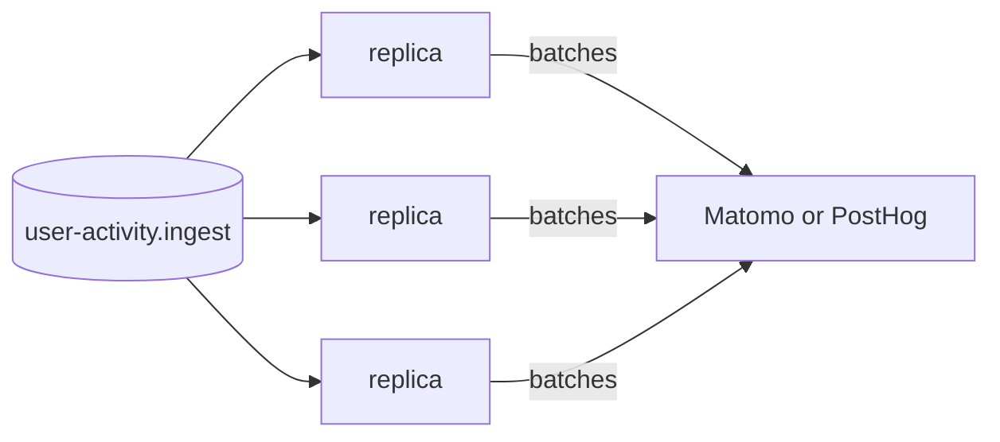

# Scaling

The bridge keeps no state. Run as many replicas as the queue needs: each takes up to `AMQP_PREFETCH` deliveries and RabbitMQ spreads them.

There is no single active consumer, so every replica works at once and messages can reach the backend out of order.

- Matomo places each hit at its own time, whatever order it arrives in.
- PostHog does the same for events, but a person property such as `paying` keeps the value that arrived last.
