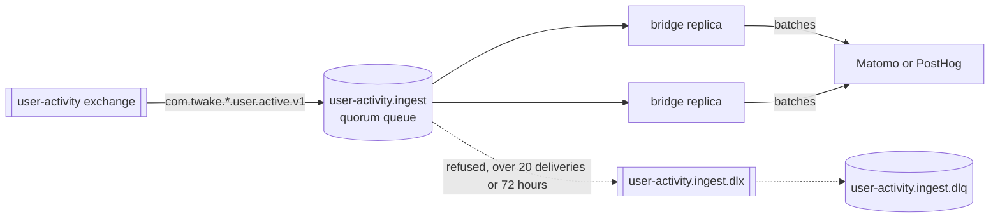

# Running the bridge

The bridge is stateless. Run as many replicas as the queue needs: each takes up to `AMQP_PREFETCH` deliveries and RabbitMQ spreads them. The queue has no single active consumer, so every replica works at once and order between messages is not kept. Configuration is in the README.

## Probes

- `GET :8080/health/ready` answers 200 once the bridge consumes the queue, and 503 while it starts or shuts down.
- `GET :8080/health/live` answers 503 when the broker connection has been down for more than a minute, when the subscription was lost after a reconnect, or when one delivery has been in progress for more than five minutes. Restarting the pod is the right fix for each of these.

A backend outage does not fail either probe. The bridge keeps the messages in the queue and retries, so restarting it would not help.

## Metrics

Prometheus text on `:9464/metrics`.

- `twake_user_activity_events_total{outcome}`: handler attempts. `handled` went to the backend, `dropped` was not a valid activity, `dead_lettered` was refused by the backend, `failed` will be retried. A retried message counts once per attempt.
- `twake_user_activity_backend_requests_seconds{backend,result}`: a summary of backend batch requests. `result` is `ok`, `unreachable` for a network error or timeout, the HTTP status when the backend answered with an error, or `error` when Matomo answered 200 without tracking the batch.

Alerts worth having:

- `failed` growing for more than a few minutes: the backend is down or refuses the token. The logs say which (`the analytics backend refused our key` means the token).
- Any `dead_lettered`: the backend refused events, for example an app missing from `MATOMO_SITES`.
- A steady rate of `dropped`: an app publishes events the bridge cannot use. The warning in the logs carries the routing key, which names the app.
- The depth of `user-activity.ingest` and `user-activity.ingest.dlq`, from RabbitMQ's own metrics.

## The dead letter queue

A message lands in `user-activity.ingest.dlq` when the backend refused it, when it was not JSON, or when it stayed in the main queue for 72 hours (a long backend outage). The body is the original event, untouched. Nothing expires it, so a full DLQ is a sign to act on.

Once the cause is fixed, move the messages back to `user-activity.ingest`: the bridge reads the app from the event body and the source exchange from the header RabbitMQ added when it dead lettered the message, so the routing key does not matter. RabbitMQ's shovel does this (the "Move messages" form of the management UI, which needs the `rabbitmq_shovel` and `rabbitmq_shovel_management` plugins). Events that are still invalid come back to the DLQ.

Matomo keeps a replayed event at its original time, so reports for past days change after the next archiving.

## Switching backends

Set `ANALYTICS_BACKEND` and the new backend's settings, then roll the deployment. History stays in the old backend: the bridge does not copy it. The pseudonymous user ids are the same in both as long as `PSEUDONYM_PEPPER` does not change.

## Matomo reports

Matomo computes reports by archiving. Run `core:archive` from cron and turn off browser-triggered archiving, as Matomo recommends for production; otherwise reports for past days only refresh when someone opens them in the browser.
